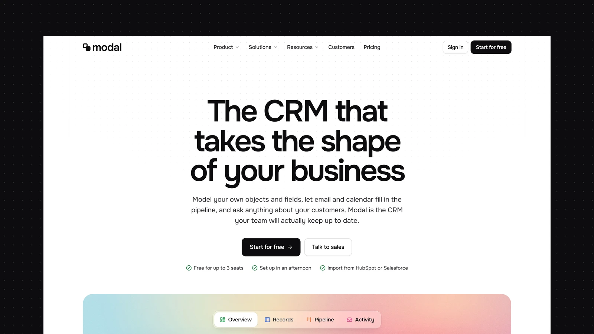

# FXN Holdings — Astro website

Production: https://fxnholdings.com/

Cloudflare Pages project: `fxnholdings-com`. Production deploys from `main`, with the repository root as the build directory, `npm run build` as the build command, and `dist` as output. `.node-version` pins Node.js 24.18.1 for the Astro build.

Uses the XOCO Modal theme with current FXN Holdings content imported on 23 October 2026 from https://fxnholdings.com/. Original SVG logo extracted from the live header into `public/fxn-holdings-logo.svg` and `src/assets/brand/logo.svg`.

- `src/data/`: page content, home content and 14 portfolio entries.
- `src/config/site.ts`: navigation, contact details and metadata.
- `src/pages/index.astro`, `src/components/home/FxnHero.astro`, `FxnSections.astro` and `src/config/fxn.ts`: homepage adapted from the Modal reference, with FXN copy and interactive platform tabs.
- `src/pages/about.astro` and `contact.astro`: Modal-inspired company and contact layouts. `src/pages/[...page].astro`: capability, technology and policy pages.
- `src/content/blog/`: seven existing FXN articles, served at `/insights/`.
- Contact follows the Modal layout and prepares a draft in the visitor’s email app. No email is sent automatically; no email credentials or chat service are configured.

Business disclosures are centralized in `src/config/businesses.ts`. UK details were supplied by the owner; name, company number and registered office were checked against Companies House. VAT is owner-supplied. The existing Australian website operator and policy responsibilities remain in place; do not infer platform operator assignments or joint data controllers from the shared brand. Confirm the Australian legal holder and each platform’s operator before adding entity-specific labels.

Run `npm run release:check` to validate and build. Run `npm run preview:pages` to serve port 8789. Production pages allow search indexing. Global logo-derived colours and the 1366px maximum container width live in `src/styles/global.css`. Headings (H1–H6) and title styles use self-hosted Inter at weight 700; body text uses Onest. Inter font files and the SIL Open Font License are in `public/fonts/inter/`.

---

# Modal - Astro SaaS Theme

[](https://modal.xocoweb.workers.dev/)

[](https://astro.build/)
[](https://tailwindcss.com/)
[](https://www.typescriptlang.org/)
[](./LICENSE)

**Live preview:** https://modal.xocoweb.workers.dev/

Modal is a premium Astro theme for SaaS and product companies. Black and white with bright accents, hairline grid rails and a crisp grotesk give it a calm, precise feel, and soft grain gradients behind the product give it warmth. The product is shown through app screens built in HTML and CSS, so they stay sharp at any size, and the output is fully static.

## Features

- A soft grain gradient behind the product windows, cards, and closing call to action, cropped from one image so the colours stay consistent
- A tabbed product window in a frosted browser frame, with dashboard, records, pipeline, and activity screens
- Product UI built in HTML and CSS (dashboard, records table, pipeline board, record timeline, reports, AI answer panel) that stays sharp at every size
- A full-width mega menu with colour-coded icon tiles and a featured card per menu, plus a full-screen mobile menu
- Hairline grid rails down the page with square markers where sections meet
- A colour system of seven accents, each with a tint and a text-safe shade, used for product areas, tags and topics
- A data model bento grid, an inbox sync split, a dark AI section, automation cards and a reports dashboard on the homepage
- An integrations marquee of real connector icons in their brand colours, with 27 connectors included
- Customer stories with a large feature quote and metric cards
- A pricing page with a billing toggle, four per-seat plans, and a sticky comparison table with a one-plan view on phones
- Four solution pages from one template, each with its own product screen, templates, story and FAQ
- A filterable, searchable integrations page
- Customers, about, careers, and contact pages
- A blog with a lead post, colour-coded topics, a table of contents with scroll-spy, a reading-progress bar, co-authored bylines, and a share sheet
- Client-side blog search as a keyboard palette (`/` or `⌘K`) and a results page
- Canonical URLs, sitemap, RSS, `robots.txt`, Open Graph, Twitter/X cards, and JSON-LD
- Self-hosted Onest and JetBrains Mono, Lucide icons, and colour, radius, and type tokens in one stylesheet
- Static output with no framework islands; every animation settles under `prefers-reduced-motion`
- Skip link, landmarks, labelled controls, visible focus states, and keyboard support for every menu, tab set, and dialog

## Tech Stack

- Astro 7 with MDX
- Tailwind CSS 4 via the Vite plugin
- Vite 8, TypeScript, Astro content collections
- `@astrojs/sitemap`, `@astrojs/rss`, Sharp
- Self-hosted Onest and JetBrains Mono, Lucide and Bootstrap Icons, Simple Icons for integrations, each with its license notice

## Requirements

- Node.js `22.12.0` or newer
- npm

## Getting Started

```bash
npm install
npm run dev
```

Build for production:

```bash
npm run build
```

Preview the production build locally:

```bash
npm run preview
```

Before shipping a change, run type checking, the production build, and the formatter check together:

```bash
npm run release:check
```

## Customization

See [CUSTOMIZATION.md](./CUSTOMIZATION.md) for site settings, the dropdown menu, the background gradient, homepage sections, the product UI and its demo data, customers, solution pages, integrations, pricing, the contact, about and careers pages, the blog, sharing, search, feeds, the newsletter form, and the theme's design tokens.

Set `siteConfig.siteUrl` in [src/config/site.ts](./src/config/site.ts) before building — canonical URLs, share images, the sitemap, and the feed are all derived from it. The build is static, so any host that serves a directory works: `wrangler.jsonc` is included for Cloudflare Workers, and Netlify, Vercel, GitHub Pages, and object storage behind a CDN need no configuration beyond `npm run build`.

## Content

Posts live in [src/content/blog](./src/content/blog). Each post is a folder with an `index.md` (or `index.mdx`) and a cover image beside it, validated by the schema in [src/content.config.ts](./src/content.config.ts). Authors and topics are defined in [src/config/blog.ts](./src/config/blog.ts).

The bundled demo content is fictional — the company, the authors, the customers, the quotes, and the figures are invented, so **replace them before launch.** The customer and team portraits are stock placeholders of people with no connection to the names and quotes beside them, and the customer logos are fictional marks.

The product UI shows a fictional app with demo data in [src/config/demo.ts](./src/config/demo.ts); replace its data or swap it for screenshots of your own product.

The integration icons come from [Simple Icons](https://simpleicons.org/) under CC0. The brands are trademarks of their owners, appear as placeholder content only, and imply no endorsement or partnership.

Demo photography comes from [Pexels](https://www.pexels.com/) under its license, credited in [src/config/customers.ts](./src/config/customers.ts), [src/config/about.ts](./src/config/about.ts), [src/config/careers.ts](./src/config/careers.ts), and [src/config/blog.ts](./src/config/blog.ts). Blog cover photos are credited under each post.

## Support

See [SUPPORT.md](./SUPPORT.md) for what a license includes, and [CHANGELOG.md](./CHANGELOG.md) for release history.

## License

Commercial license. See [LICENSE](./LICENSE) for complete terms.

## Credits

- [Onest](https://github.com/googlefonts/onest) by the Onest Project Authors, under the SIL Open Font License
- [JetBrains Mono](https://github.com/JetBrains/JetBrainsMono) by JetBrains, under the SIL Open Font License
- The fictional company logos are set in Fraunces, Space Grotesk, Syne, Archivo Black, Outfit, DM Serif Display, Sora, Unbounded, Manrope, and IBM Plex Mono, all under the SIL Open Font License, converted to outlines
- [Lucide](https://lucide.dev/), under the ISC License
- [Bootstrap Icons](https://icons.getbootstrap.com/), under the MIT License
- [Simple Icons](https://simpleicons.org/), under CC0
- Photography from Pexels, credited per image
